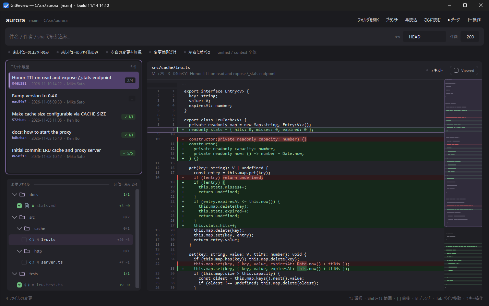
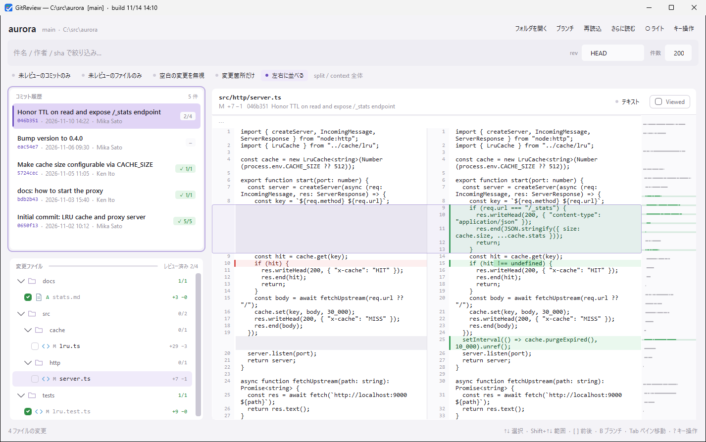
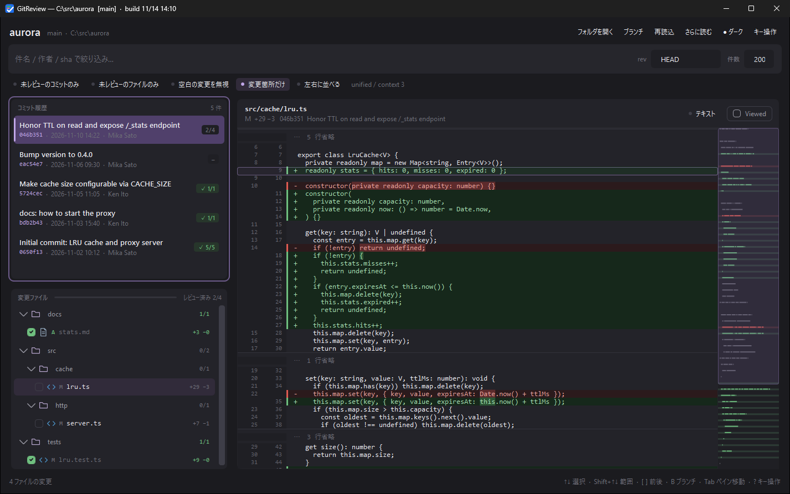

<div align="center">


# GitReview

**ローカルの git だけで完結する、キーボード駆動のコードレビュー GUI**

コミットを選び、ファイルごとに差分を読み、読み終えたら <kbd>Enter</kbd>。<br>
GitHub の「Viewed」と同じ感覚を、プッシュ前のローカルの履歴で。




</div>

## ✨ 特徴

| | |
| --- | --- |
| ⌨️ **キーボードだけで読み切れる** | `Enter` で「このファイルは見た、次へ」。`Ctrl+D` / `Ctrl+U` で変更箇所から変更箇所へ、画面の中央に寄せながら送る |
| ✅ **進捗が残る** | ファイルごとのレビュー済みをコミット単位で記録。履歴に `2/4`、`✓ 5/5` と進み具合が並ぶ。amend や rebase で作り直されたコミットでも、中身が変わっていないファイルのチェックは引き継ぐ |
| 🔍 **読みやすい差分** | 語単位のハイライト、unified / split の切り替え、ファイル全体表示と「変更箇所だけ」表示、VS Code 風のミニマップ |
| 🪶 **軽い** | 単体の EXE（約 0.8 MB）。インストーラーも NuGet 依存も無し。何万行の差分でも仮想化してさらさら動く |
| 🔒 **リポジトリに触れない** | git は読み取り専用で呼ぶだけ。checkout もしないし、`.git` にも何も書かない |
| 🔄 **チームに配れる** | 共有フォルダに 1 つ置けば全員の PC で動き、上書きすると起動中の全員が数秒で新しい版に切り替わる |

<table>
  <tr>
    <td width="50%"></td>
    <td width="50%"></td>
  </tr>
  <tr>
    <td align="center"><sub>ライトテーマ / 左右に並べる（split）</sub></td>
    <td align="center"><sub>変更箇所だけ — 省略した行数を控えめに表示</sub></td>
  </tr>
</table>

## 🚀 はじめる

### 必要なもの

- Windows 11（または Windows Server 2025 のデスクトップエクスペリエンス）、x64
- [.NET 10 Desktop Runtime (x64)](https://dotnet.microsoft.com/download/dotnet/10.0)
- `git` が PATH にあること

### ビルドと起動

```powershell
git clone https://github.com/uchi-ta/git-review.git
cd git-review
powershell -ExecutionPolicy Bypass -File tools\build.ps1    # -> .\GitReview.exe
.\GitReview.exe C:\path\to\repo
```

ビルドには [.NET 10 SDK](https://dotnet.microsoft.com/download) が要ります。

### コマンドライン

```powershell
GitReview.exe                              # 前回のリポジトリ（無ければカレントディレクトリ）
GitReview.exe C:\path\to\repo              # 指定したリポジトリを開く
GitReview.exe C:\path\to\repo 1a2b3c4      # そのコミットを開いた状態で起動
GitReview.exe C:\path\to\repo feature/x    # ブランチ名など git が解決できる書き方でもよい
```

リポジトリ配下のどのフォルダを渡しても、ルートに解決されます。

## 📖 使い方

左上がコミット履歴、左下がそのコミットの変更ファイル、右が差分です。

1. **コミットを選ぶ** — `J` / `K` で移動。複数選ぶと、その範囲をまとめた差分になる
2. **ファイルを読む** — 開くと最初の変更箇所が画面の中央に来る。`Ctrl+D` で次の変更へ
3. **読み終えたら `Enter`** — レビュー済みにして、次の未レビューのファイルへ進む
4. コミットを読み終えても、勝手に次のコミットへは移らない。`]` で次へ

迷ったら <kbd>?</kbd>。画面の下の帯にも、今いるペインでよく使うキーが出ています。

### 差分の表示

- **ファイル全体**が既定。`C` で「変更箇所だけ」（前後 3 / 8 / 25 行）に切り替え。行番号はどちらでもファイル内の番号のまま
- **語単位のハイライト** — 対になった削除行と追加行は、実際に変わった語だけを濃く表示
- **split / unified** — `S` で切り替え。split でも各列の中で折り返すので、行がずれない
- **ミニマップ** — 右端のスクロールバーにコードの縮小イメージと追加・削除の帯。押すかドラッグでその位置へ
- **今いる変更箇所**を薄い枠で囲み、これ以上送る先が無いときは控えめな案内を出す
- **文字の選択とコピー** — 色が付いたままドラッグで選べる。ダブルクリックを重ねると 語 → 行 → `@@` の塊 → 全体 と広がる（VS Code と同じ）
- `Ctrl` + ホイールで文字を拡大・縮小。左のペインと仕切りの位置も一緒に拡大する

### ブランチ

`B` でブランチを名前で絞り込んで選べます。ローカルとリモート追跡の両方を、最近動いた順に。
選ぶと履歴がそのブランチに切り替わるだけで、**checkout はしません**。

`rev` 欄には `HEAD` 以外に、ブランチ名、`--all`、`main..feature` なども書けます。

### 自動で追従する

- commit・checkout・fetch などで `HEAD` や `refs` が動くと、履歴を自動で読み直す（読んでいたコミットが残っていれば位置はそのまま）
- ウィンドウの位置と大きさ、仕切り、文字の倍率、各トグルは記憶する

## ⌨️ キー操作

<details>
<summary><b>一覧を開く</b>（アプリ内でも <kbd>?</kbd> / <kbd>F1</kbd> で見られます）</summary>

| キー | 動作 |
| --- | --- |
| `O` / `Ctrl+O` | リポジトリのフォルダを開く |
| `B` | ブランチを探して表示を切り替え |
| `R` / `F5` | 再読込 |
| `L` | コミットをさらに 200 件読む |
| `Ctrl+F` | 絞り込み入力へ |
| `Tab` / `Shift+Tab` | ペインを移動 |
| `1` / `2` / `3` | コミット / ファイル / 差分 ペインへ |
| `J` / `K` | 選択を下 / 上へ（差分ペインではスクロール） |
| `G` / `Shift+G` | 先頭 / 末尾へ |
| `[` / `]` | 前 / 次のコミット |
| `Shift+↑` / `Shift+↓` | コミットを範囲選択 |
| **`Enter`** | **レビュー済みにして次の未レビューのファイルへ** |
| `Shift+Enter` | 未レビューに戻して前へ |
| `Space` / `X` | レビュー済みを切り替え（その場に留まる） |
| `Ctrl+E` | レビュー済みを切り替え（付けたときは次へ進む）。入力欄にいても効く |
| `N` / `P` | 次 / 前のファイル |
| `A` / `Shift+A` | 全ファイルをレビュー済み / 未レビューに |
| `U` / `Shift+U` | 未レビューのファイル / コミットだけを表示 |
| `Ctrl+D` / `Ctrl+U` | 次 / 前の変更箇所へ（画面の中央に寄せる） |
| `C` | 全体 → 前後 3 → 8 → 25 行 |
| `S` | split / unified |
| `W` | 空白だけの変更を無視 |
| `V` | プレーンテキスト表示（`Ctrl+A` で全選択したいとき） |
| `←` / `→` | フォルダを閉じる / 開く |
| `E` / `Shift+E` | フォルダをすべて開く / 閉じる |
| `Ctrl+ホイール` | 文字の拡大 / 縮小（`Ctrl++` / `Ctrl+-` / `Ctrl+0`） |
| `Ctrl+C` | 選択した範囲をコピー |
| `Ctrl+Shift+C` | ファイルパスをコピー |
| `T` | テーマ切り替え（OS / ライト / ダーク） |
| `?` / `F1` | キー操作の一覧 |

</details>

## 👥 チームに配る

共有フォルダに置いた EXE を各自が起動する使い方を想定しています。

```powershell
powershell -ExecutionPolicy Bypass -File tools\deploy.ps1 -Share '\\server\share\tools'
```

- 起動した EXE は自分自身をローカル（`%LOCALAPPDATA%\GitReview`）へ写して動くので、共有側はロックされない
- **起動中のマシンは 5 秒以内に更新に気づき、新しい版で起動し直す。** 読んでいたリポジトリ・コミット・ファイルはそのまま
- 配布は隣の `.part` に書いて SHA-256 で照合してから置き換えるので、書きかけの EXE を拾うことはない
- 初回起動でスタートメニューにショートカットができる。ピン留めはこちらから

<details>
<summary><b>起動の流れと復旧</b></summary>

```
\\server\share\tools\git-review\GitReview.exe      初回だけ直接実行
        ↓ 自分自身をローカルへ写す
%LOCALAPPDATA%\GitReview\GitReview.exe             ショートカットの実体
        ↓ 配布元から版を取り込んで起動
%LOCALAPPDATA%\GitReview\app\<版>\GitReview.exe     実際に動くアプリ
        ↓ 5 秒ごとに配布元の版を確認し、変わっていれば乗り換える
```

- コピーは SHA-256 で検証し、合わなければ 3 回までやり直す
- 新しい版が 45 秒以内に動き出さなければ、その版を消して元の版のまま知らせる
- 経過は `%LOCALAPPDATA%\GitReview\launch.log` に残る
- `--no-stage` を付けるとコピーせずその場で動く（開発用）

ローカルの配布物が壊れたときは、レビュー記録と設定を残したまま配布物だけを消せます。

```powershell
powershell -ExecutionPolicy Bypass -File tools\setup-runtime.ps1 -Reset
```

</details>

### エクスプローラーの右クリック

起動時に「**GitReview で開く**」を右クリックメニューに登録します。

| PC の状態 | 出る場所 |
| --- | --- |
| 署名用の証明書を信頼している | Windows 11 の上位のメニュー |
| していない | 「その他のオプションを表示」の中 |

上位のメニューに出すには、管理者で 1 回だけ次を実行します（公開鍵だけの `.cer` を `LocalMachine\TrustedPeople` に入れます）。

```powershell
powershell -ExecutionPolicy Bypass -File tools\setup-runtime.ps1 -TrustCertificate
```

<details>
<summary><b>上位メニュー用の DLL とパッケージのビルド</b></summary>

Windows 11 の上位メニューに出せるのは、署名した Sparse パッケージに入った `IExplorerCommand` だけです。
`shell\` にハンドラー（C++）とマニフェストがあり、Visual Studio 無しで、llvm-mingw と NuGet の Windows SDK BuildTools を
`shell\.toolchain` に取得してビルドします。

```powershell
powershell -ExecutionPolicy Bypass -File shell\build-shell.ps1   # -> shell\out\
```

署名にはビルドする人の `CurrentUser\My` の自己署名証明書（無ければ作る）を使います。
証明書を作り直すと各 PC で `-TrustCertificate` のやり直しが要るので、ビルドは同じ PC・同じユーザーで行います。

</details>

## 💾 保存するもの

すべて `%LOCALAPPDATA%\GitReview\` の下。リポジトリと共有フォルダには何も書きません。

| パス | 内容 |
| --- | --- |
| `state\<リポジトリ名>-<ハッシュ>.json` | レビュー記録（キーはコミットの sha） |
| `settings.json` | 最後に開いた場所、テーマ、各トグル、文字の倍率、ウィンドウと仕切り |
| `app\<版>\` | 実際に動くアプリ |
| `launch.log` | 配布・起動の経過 |

レビュー記録のキーはコミットの sha なので、記録が古くなることはありません。
`amend` や `rebase` で sha が変わっても、**同じ親から作り直されたコミットなら、中身が変わっていないファイルのレビュー済みを引き継ぎます**。
変わったファイルだけが未レビューに戻るので、読み直すべき場所だけが残ります。

## 🏗️ 構成

<details>
<summary><b>ソースの地図</b></summary>

| パス | 役割 |
| --- | --- |
| `Core\GitClient.cs` | git CLI の呼び出し（読み取り専用、リモートには触れない） |
| `Core\DiffParser.cs` | unified diff を行番号付きの表示行と side-by-side の行へ |
| `Core\WordDiff.cs` | 対になった行の語単位の差分 |
| `Core\DiffText.cs` | 語ハイライトを TextBlock へ描く添付プロパティ |
| `Core\ReviewStore.cs` | レビュー記録の永続化 |
| `Core\RepoWatcher.cs` | `HEAD` と `refs` の変化を見張る |
| `Core\Stage.cs` | ローカルへの自己コピーと更新検知 |
| `Core\ShellMenu.cs` / `Core\ShellPackage.cs` | 右クリックメニューの登録 |
| `Core\ResultCache.cs` | ファイル一覧と差分の MRU キャッシュ |
| `Core\Theme.cs` / `Core\Zoom.cs` | 配色と文字の倍率 |
| `MainViewModel.cs` | 画面の状態と git / 永続化の呼び出し |
| `MainWindow.xaml(.cs)` | 画面とキーボード操作 |
| `DiffOverview.cs` | ミニマップ（差分ごとに 1 度だけ組み立てて使い回す） |
| `DiffTextSelector.cs` | 仮想化した一覧の上に選択範囲を描く |
| `DiffBlockMarker.cs` | 今いる変更箇所の枠 |
| `shell\` | 上位メニューのハンドラーとパッケージ |

</details>

### 仕様上の注意

- マージコミットは**第 1 親との差分**（`git diff <sha>^ <sha>` と同じ）
- 最初のコミットは空ツリーとの差分
- リネームは `-M -C` で検出し、`旧パス → 新パス` と表示
- 作業ツリーの未コミットの変更は対象外。コミット済みの履歴だけを見る
- 画面の表示は日本語のみ

## License

[MIT](LICENSE)
